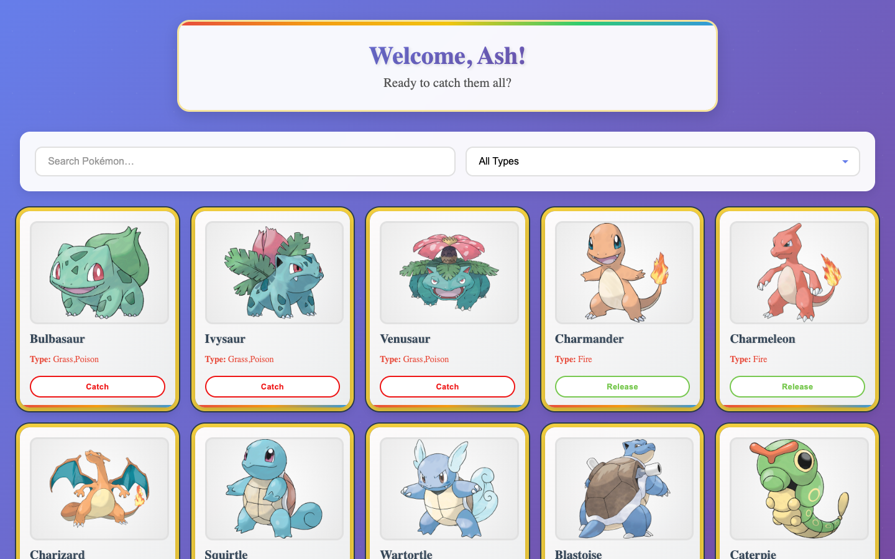
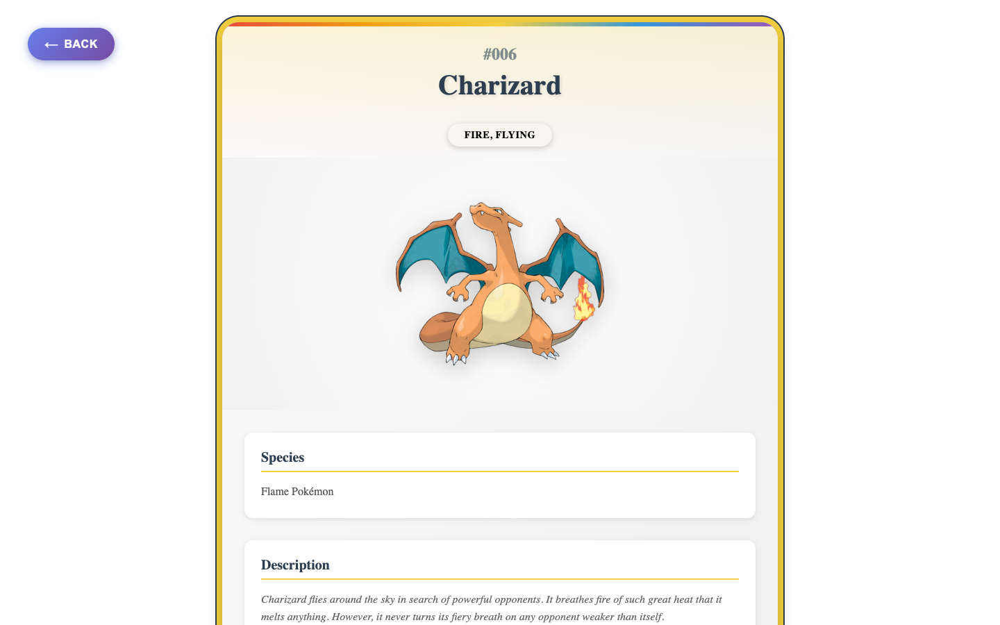

<div align="center">

# ⚡ Pokédex

### A full-stack TypeScript monorepo for browsing and collecting Pokémon


</div>

<p align="center">
  
  
</p>

## Overview

Users sign up, browse more than 800 Pokémon with search, filters and pagination, and build a personal collection. The interesting part is the **evolution rule**: catching an evolved Pokémon (say, Charizard) automatically marks its earlier forms (Charmander and Charmeleon) as owned. The backend enforces this with a recursive walk of the evolution chain, and the frontend updates every cached page in place.

## Highlights

- **Monorepo with shared types.** The frontend and backend share one `@pokedex/shared-types` package, so the API contract is type-checked on both sides.
- **Layered backend.** Routes → services → repositories, with dependency injection and Zod validation on every request.
- **Secure auth.** bcrypt password hashing, JWTs, route guards, and an HTTP interceptor that handles 401s.
- **Reactive frontend.** Angular 19 standalone components with Signals and RxJS, smart/presentational component split, and client-side caching that stays in sync after mutations.
- **One-command dev environment.** `docker compose` brings up Postgres, the API and the UI, and seeds the database on first run.
- **Code quality.** TypeScript strict mode everywhere, ESLint, Prettier, Husky with lint-staged, and Jest unit tests.

## Architecture

```text
┌──────────────────────────┐        ┌──────────────────────────────────────┐
│  Angular 19 SPA          │  HTTP  │  Hono API                            │
│  • Signals + RxJS state  │ ─────► │  Routes      (Zod validation, JWT)   │
│  • Auth guard/interceptor│  JSON  │     ↓                                │
│  • Cached, synced pages  │        │  Services    (evolution logic)       │
└──────────────────────────┘        │     ↓                                │
             ▲                      │  Repositories (SQL data access)      │
             │                      └──────────────────┬───────────────────┘
             │  @pokedex/shared-types                  ↓
             └──────────────────────────────── PostgreSQL 16
```

```text
apps/
  backend/     Hono REST API: routes, services, repositories, middleware
  frontend/    Angular 19 SPA: pages, core services, shared components
libs/
  shared-types/  Types shared by the frontend and backend
```

## Getting started

**Prerequisites:** Docker, Node.js 18+, and pnpm 8+.

```bash
git clone https://github.com/GoldbergOanna/pokedex-monorepo.git
cd pokedex-monorepo
pnpm install
pnpm dev          # starts Postgres, the API on :3000, and the UI on :4200
```

Then open <http://localhost:4200>.

To run the backend outside Docker, copy `.env.example` to `.env` and adjust the values.

| Command | What it does |
|---|---|
| `pnpm dev` | Build and start all services with Docker Compose |
| `pnpm dev:down` | Stop everything and remove volumes |
| `pnpm lint` / `pnpm format` | Lint and format the whole repo |
| `pnpm --filter @pokedex/backend test` | Backend unit tests |
| `pnpm --filter @pokedex/frontend test` | Frontend unit tests |

## API

| Method | Endpoint | Description |
|---|---|---|
| `POST` | `/auth/register` | Create an account and return a JWT |
| `POST` | `/auth/login` | Log in and return a JWT |
| `GET` | `/pokedex` | Paginated list. Query params: `page`, `limit`, `search`, `type` |
| `GET` | `/pokedex/:id` | Full details, including stats and the evolution chain |
| `GET` | `/me/collection` | IDs of the Pokémon the user owns |
| `POST` | `/me/collection/:id/toggle` | Catch or release a Pokémon. Returns every affected ID, including pre-evolutions |

## Tech stack

**Backend:** Node.js, Hono, PostgreSQL (`pg`), Zod, JWT, bcrypt
**Frontend:** Angular 19, Signals, RxJS, SCSS
**Tooling:** pnpm workspaces, Docker Compose, ESLint, Prettier, Husky, Jest

## Contact

**Oana Goldberg**, senior full-stack engineer · [LinkedIn](https://www.linkedin.com/in/goldbergoana) · [GitHub](https://github.com/GoldbergOanna)
